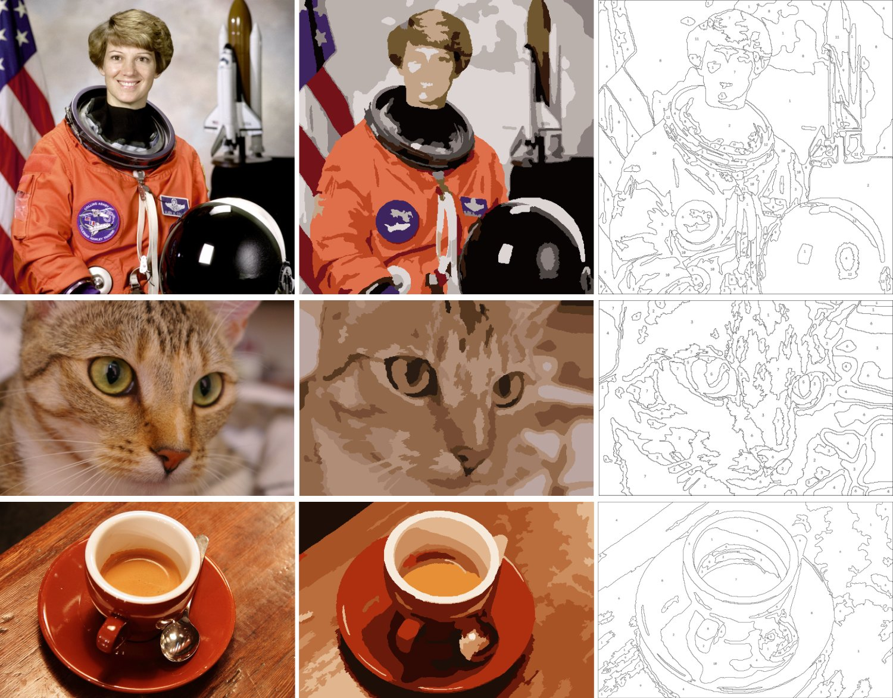

# stitch-regions

**Turns a photo into a small set of clean, stitchable colour regions, then exports the same geometry as an SVG, a numbered colour-by-number chart and a JSON file of region polygons, with each colour matched to an embroidery thread.**



*Left to right: original photo · pattern in stitch colours · numbered chart. Test photos are openly licensed: NASA portrait (public domain), "Chelsea the cat" (CC0, Stefan van der Walt) and a coffee cup (CC0, Rachel Michetti). All three come from the scikit-image sample data. The logo test image was drawn for this demo.*

## How it works

1. **Clean up the photo:** an edge-preserving filter removes grain and texture but keeps outlines.
2. **Colour clustering:** k-means in CIELAB, a perceptual colour space, groups the photo into *N* colours (default 12).
3. **Stitchable regions only:** any region smaller than a minimum area **in mm² at the chosen hoop size** (default 9 mm² on a 150 mm design) is merged into the neighbouring colour it shares the longest border with. This repeats until nothing is too small.
4. **Thread matching:** each colour is matched to the nearest thread by CIEDE2000 colour difference. Colours that land on the same thread are merged, because a stitcher would use one thread for both.
5. **One geometry for every output:** polygons, with holes, are traced once. The SVG, the JSON and the numbered chart are all drawn from those same polygons, so they agree with each other. Shared borders are drawn once, not twice.

## Measured results

| Image | Colours | Regions (raw → stitchable) | Smallest region (mm²) | Mean ΔE2000 vs photo | Mean ΔE2000 to thread | Output consistency |
|---|---|---|---|---|---|---|
| Portrait (astronaut) | 12 | 4,889 → 172 | 9.4 | 6.01 | 6.37 | 99.71% |
| Pet (cat) | 7 | 2,861 → 100 | 9.1 | 6.18 | 5.99 | 99.76% |
| Object (coffee) | 10 | 10,281 → 70 | 9.3 | 5.35 | 7.61 | 99.66% |
| Logo (drawn) | 4 | 154 → 8 | 55.1 | 1.64 | 4.14 | 99.90% |

- **Regions raw → stitchable:** the speckle a naive colour reduction produces, compared with what remains after the minimum-area rule. Every remaining region meets the 9 mm² minimum.
- **ΔE2000:** perceptual colour difference. Around 2 is just noticeable, and 5–7 is a visible but faithful simplification.
- **Output consistency:** the % of pixels where the exported polygons and the chart agree exactly. With `--simplify-mm 0` (pixel-exact edges) it is **100%**. The default 0.2 mm smoothing trades a few hairline pixels on shared borders for cleaner stitch lines.

## Outputs (per image)

| File | What it is |
|---|---|
| `pattern.svg` | Vector regions at real size (mm), each tagged with its colour number and thread code |
| `colour_by_number.png` | Numbered outline chart with a thread legend |
| `regions.json` | Every region: colour, area in mm², label point, outer polygon and holes |
| `metrics.json` | Settings, measurements and the thread palette (share of design, region count, ΔE to thread) |
| `preview.png` / `comparison.png` | Filled preview and side-by-side comparison |

## Run it

Create an isolated environment and install the original project dependencies first:

```bash
python -m venv .venv
# Activate .venv using your platform
python -m pip install -e .
```

The commands below use POSIX-style `PYTHONPATH=src`. On Windows PowerShell, run `$env:PYTHONPATH = "src"` first, or use the installed package without setting `PYTHONPATH`.


Requires Python 3.11+, `opencv-python` and `numpy`, declared in `pyproject.toml`.

```bash
PYTHONPATH=src python -m stitchregions.cli demo/images/pet_chelsea.png --out outputs/cat \
    --colours 12 --hoop-mm 150 --min-region-mm2 9 --simplify-mm 0.2
PYTHONPATH=src python -m unittest discover -s tests -v     # 7 tests, incl. published CIEDE2000 reference pairs
```

**Settings that matter:**
- `--colours`: thread budget.
- `--hoop-mm`: design size, which converts pixels to mm.
- `--min-region-mm2`: the smallest area worth stitching.
- `--simplify-mm`: edge smoothing (0 = exact).

## Limits and next steps for a full study

- **Thread colours:** `threads_dmc_approx.csv` holds **approximate** on-screen RGB values for 46 common DMC colours from public conversion charts. Confirm against a physical colour card. Swapping in a full, verified thread list (same CSV columns) also fixes colour merging; for example, the cat collapsed to 7 colours because the small list has few close browns.
- **Faces and fine detail:** features such as eyes and spoon edges can merge into neighbours at small hoop sizes. A face-aware or edge-weighted mode would protect them.
- **Fully shared borders:** the next step for perfectly gap-free borders at any smoothing is shared-edge (topological) simplification, where each border is simplified once for both neighbouring regions.
- **Stitch direction:** stitch direction and fill type per region are out of scope for this proof of concept.

MIT licensed.

## 90-second demonstration walkthrough

[Watch the captioned walkthrough](docs/walkthrough_90s_captioned.mp4) or read the [voiceover narration script](docs/WALKTHROUGH_NARRATION.md). The video is silent and uses synthetic or openly licensed example images, not confidential client images. It does not establish production-ready embroidery digitisation.
